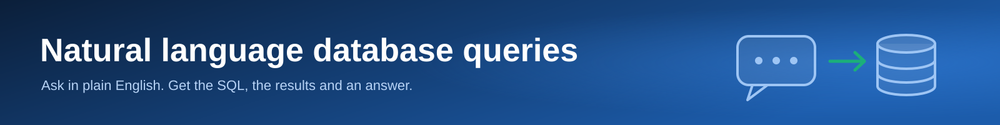

[](https://langstuff.streamlit.app/)

# LangStuff

A learning project for LangChain and LangGraph. It starts with the basics in a
notebook and builds up to a Streamlit app where you ask an Oracle database
questions in plain English.

**Live app:** <https://langstuff.streamlit.app/> (hosted on Streamlit Community Cloud;
you may be asked to sign in)

## What's in here

| Path | What it is |
|------|------------|
| `LangChain01.ipynb` | LangChain 101 with Google Gemini: models, messages, prompt templates, LCEL chains (`prompt \| llm \| parser`), streaming, and structured output with Pydantic. |
| `FreeSQLTest.ipynb` | A minimal connection test for Oracle FreeSQL using `oracledb`. |
| `Evaluation.ipynb` | Scores the agent on a bank of 39 questions (10 answerable and 3 honest-failure questions per schema): accuracy, first-attempt success, recovery rate and honest failures. |
| `Streamlit/app.py` | The Streamlit front end: sidebar settings, chat input, and answer / SQL / results / agent-trace tabs. |
| `Streamlit/agent.py` | The LangGraph agent that turns a question into SQL, runs it, and explains the result. |
| `Streamlit/requirements.txt` | Python dependencies for the app. |

## The Streamlit app: "Ask your database"

Type a question in plain English. The app writes SQL, runs it against the
selected schema, and answers in a few sentences. Every answer comes with the SQL
that was used, the result table, and a trace of the agent's steps.

### How the agent works

The agent is a small LangGraph graph with two kinds of retry. Each box is a node,
each line is an edge. The same diagram, with a table of what each node reads and
writes, is at the top of `Streamlit/agent.py`. A numbered version sits next to the
wiring code at the bottom of `build_graph()`, so each arrow lines up with the
`add_edge` call that creates it.

```
        START
          |
          v
   +--------------+
   |  get_schema  |  read the table and column names of the chosen schema
   +--------------+
          |
          v
   +--------------+
   |  write_sql   |  ask the model for ONE SELECT statement
   +--------------+
          |
          v
   +--------------+
   |   run_sql    |  check the SQL, then run it against Oracle
   +--------------+
          |
          |  after_run() picks the next node:
          |
          +--- the SQL failed, retries left ---------> write_sql   (try again)
          |
          +--- it ran but found nothing, retries left
          |           |
          |           v
          |    +---------------+
          |    | lookup_values |  fetch the real values of the columns it filtered on
          |    +---------------+
          |           |
          |           +------------------------------> write_sql   (try again, with hints)
          |
          +--- a good result, or no retries left
                      |
                      v
               +--------------+
               |    answer    |  turn the result into 1-3 plain sentences
               +--------------+
                      |
                      v
                     END
```

1. **get_schema**: reads the table and column names of the chosen schema from Oracle.
2. **write_sql**: asks the model for a single `SELECT` using only those tables and columns.
3. **run_sql**: checks the SQL (not too long, only real tables, a few ranking rules), then runs it. If it fails, the error goes back to `write_sql` so the model can fix its own query.
4. **lookup_values**: if the query runs but finds nothing (no rows, or a `COUNT` that comes back as 0), the model probably guessed a value wrong (for example `'United States'` instead of `'USA'`). This step fetches the real distinct values of the text columns the query filtered on, and `write_sql` retries with them.
5. **answer**: summarises the result in 1 to 3 sentences.

Both kinds of retry share one budget, `MAX_RETRIES` in `Streamlit/agent.py` (3, so up
to 4 attempts), which is why the agent always stops.

### Schemas

A dropdown in the page heading ("Ask your database about ...") picks which FreeSQL
sample schema to query, and the table list in the sidebar follows it. Each schema
keeps its own conversation and has three example questions.

- Olympic data (`OLYM`), the default
- Customer orders (`CO`)
- Human resources (`HR`)

The Olympic data appears to contain only the Summer Games (its `SEASON` column
has a single value, `Summer`), so questions about Winter Games have no answer in
it. The agent says so when that happens.

To add another, add a line to the `SCHEMAS` dictionary in `Streamlit/app.py`.

### Safety

- Only statements starting with `SELECT` or `WITH` are run.
- Results are capped at 200 rows (`ROW_LIMIT` in `Streamlit/agent.py`).
- The model sees table and column names and types when writing SQL. When writing the answer it also sees the result itself (up to about 12,000 characters of it; if a result is cut off, the model is told so and not to guess about the rest).

### Models

The agent can use more than one model, from Google Gemini, Groq and OpenRouter. Everything it needs to know about each one is in the `MODELS` table in `Streamlit/agent.py`: the company that runs it, the peak requests per minute your key allows, and any extra settings.

- `MODEL_NAME` is the model used (currently `gemini-3.5-flash-lite`). The model is built by one small factory (`make_client`, using LangChain's `init_chat_model`), so the rest of the agent does not care which company it is talking to.
- The agent spaces its calls to stay under the model's requests per minute, so each call waits its turn instead of hitting a rate-limit error.
- If the model runs out of its requests for the day (500 a day for Gemini on the free tier), the provider returns a quota error. The agent catches it and moves to the next model in `FALLBACK_MODELS`, printing a line to the log when it does. The switch lasts until the app restarts. Set `FALLBACK_MODELS = []` to turn it off.
- To add a model, add a line to `MODELS`, then use its name in `MODEL_NAME` or `FALLBACK_MODELS`. Groq models also need `pip install langchain-groq` and `GROQ_API_KEY` in `.env`; OpenRouter models need `langchain-openrouter` and `OPENROUTER_API_KEY` (both packages are in `requirements.txt`).
- Some free models are "reasoning" models that can spend their whole reply on thinking and return nothing. Their entry in `MODELS` turns the thinking down (for example `reasoning: effort none` on OpenRouter). Temporary provider errors, such as an upstream timeout, are retried twice.

`Evaluation.ipynb` checks every model in `MODELS` before it runs, and records which model answered each question.

## Setup

You need Python 3.10 or newer (developed on 3.14).

```bash
python -m venv .venv
```

Activate the environment (Windows PowerShell shown; on macOS or Linux use `source .venv/bin/activate`):

```powershell
.\.venv\Scripts\Activate.ps1
```

```bash
pip install -r Streamlit/requirements.txt
```

### The `.env` file

Secrets are kept out of git. Create a file named `.env` in the project root (the
same folder as this README) with these four keys (plus `GROQ_API_KEY` if you use a Groq model):

```
GOOGLE_API_KEY=your-google-ai-studio-key
FREE_SQL_USER=your-freesql-username
FREE_SQL_PASSWORD=your-freesql-password
FREE_SQL_DSN=your-freesql-connection-string
```

| Key | What it's for | Where to get it |
|-----|---------------|-----------------|
| `GOOGLE_API_KEY` | Calls to Gemini | A free key from <https://aistudio.google.com/apikey> (no billing needed) |
| `GROQ_API_KEY` | Calls to Groq models (optional, only if you use one) | A free key from <https://console.groq.com/keys> |
| `OPENROUTER_API_KEY` | Calls to OpenRouter models (optional, only if you use one) | A key from <https://openrouter.ai/keys> |
| `FREE_SQL_USER` | Oracle FreeSQL login | Your FreeSQL account's connection details |
| `FREE_SQL_PASSWORD` | Oracle FreeSQL password | Same |
| `FREE_SQL_DSN` | Oracle connection string | Same (an Oracle "easy connect" string, for example `host:port/service_name`) |

Notes:

- `.env` is listed in `.gitignore`. Never commit it.
- `LangChain01.ipynb` prompts for `GOOGLE_API_KEY` the first time and saves it to `.env` for you.
- On Streamlit Community Cloud there is no `.env`. Put the same four keys in the app's **Secrets** settings instead; the app reads `st.secrets` as a fallback.

## Run the app

From the project root:

```bash
python -m streamlit run Streamlit/app.py
```

Streamlit prints a local address, normally <http://localhost:8501>. In the sidebar,
click **Test connection** to confirm the database login works, then ask a question.

To run the notebooks, open them in VS Code or Jupyter with the `.venv` environment selected.

## Ideas for next steps

- Per-schema example questions on the buttons in the app.
- Follow-up questions that remember earlier turns (a LangGraph checkpointer).
- A tool-calling agent that chooses its own steps, such as listing tables or describing a table, instead of a fixed pipeline.
- A stricter SQL safety check, or a read-only database user.
